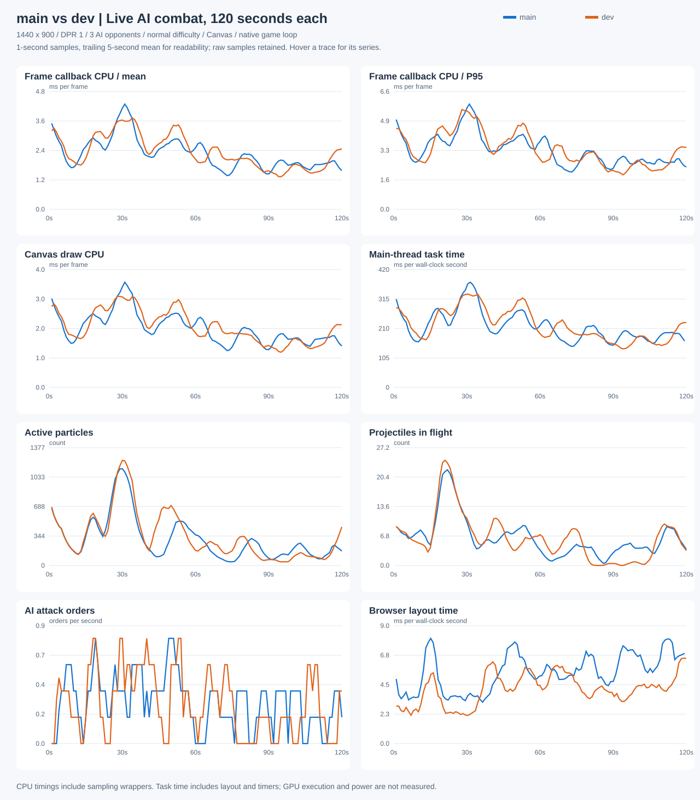

# Live AI combat performance: main vs dev

Measured on 2026-11-09. This replaces the previous short, mostly static benchmark as the evidence for live-combat behavior.

## Scenario and measurement

- Main: 73375a2, Three.js prototype reverted. Dev: 58752cc, production Vite build; default Canvas backend. No game source changes were made.
- Chromium 149.0.7827.55, headless, ANGLE (AMD, AMD Radeon 780M Graphics (0x000015BF) Direct3D11 vs_5_0 ps_5_0, D3D11). Viewport 1440 x 900, DPR 1. Runs were sequential, main then dev, 120.010 and 120.008 wall-clock seconds respectively.
- One idle human player and three AI nations (mushroom/crazy, octopus/hot, ai/zen), normal difficulty, seed 1234567. Personalities come from the original seeded setup. No ammunition, aggression, attack timers or projectile durations were overridden.
- The original simulation was advanced to game time 180 seconds before measurement, allowing development and combat to begin. This preparation was unmeasured. All three AI nations were alive at the start. The normal game loop then ran against native RAF timestamps for 120 real seconds at 1x speed. Slow motion, real effect lifetimes, autonomous attacks, interceptions, damage, rebuilding, HUD and browser timers remained active. Audio was excluded equally from both runs; no network transport was used.
- The test exposed an API in served/build copies only. It wrapped the existing RAF callback to measure complete synchronous callback cost and wrapped Render.draw for draw cost. It did not replace the game loop with fixed steps, freeze effects, replay attacks or force matching combat. Initial game snapshot hashes match: true.
- Frame timestamps/costs and projectile/particle counts were collected every frame. CDP performance counters were polled approximately once per second; main-thread aggregate values use complete intervals ending before the 120-second cutoff. These counters include timers and browser layout, beyond the synchronous RAF callback. The small measurement overhead is present on both sides.
- One 120-second run per branch; no estimate of run-to-run confidence. Combat intensity is reported alongside performance. This is CPU/frame-cadence measurement, not GPU completion or energy use.

## Results

In this run, dev's mean frame callback cost was about 4.1% higher and total main-thread task time about 2.9% higher. Both branches sustained approximately 60 RAF callbacks per second with no intervals over 25 ms. Dev also had about 13.3% more particles on average and 77 explosions versus main's 69; both launched 93 munitions. These results do not demonstrate a meaningful live-combat speedup, but this single naturally diverging battle is not sufficient to establish a rendering regression either. Layout work fell by about 23.4%, a smaller share of the total workload. The drawing calls account for about 88% of synchronous game-frame CPU on both branches; this measures CPU submission, not GPU execution.

| Metric | main | dev |
| --- | ---: | ---: |
| Frame callback CPU, mean (ms) | 2.24 | 2.34 |
| Frame callback CPU, P95 (ms) | 4.00 | 4.10 |
| Canvas draw CPU, mean (ms) | 1.97 | 2.05 |
| Main-thread task time (ms/s) | 214.78 | 221.07 |
| Layout time (ms/s) | 5.52 | 4.23 |
| Observed FPS | 60.00 | 60.00 |
| Frame interval P95 (ms) | 16.70 | 16.70 |
| Frame interval P99 (ms) | 16.80 | 16.80 |
| Frame gaps >25 ms | 0.00 | 0.00 |
| Frame gaps >50 ms | 0.00 | 0.00 |
| AI attack orders | 38.00 | 37.00 |
| AI-to-AI attack orders | 6.00 | 3.00 |
| Launched munitions | 93.00 | 93.00 |
| Explosions | 69.00 | 77.00 |
| Interceptions | 28.00 | 19.00 |
| Mean particles | 301.72 | 341.84 |
| Peak particles | 1336.00 | 1607.00 |
| Mean in-flight projectiles | 6.31 | 6.26 |
| Peak in-flight projectiles | 23.00 | 25.00 |

Mean callback cost changed by 4.1%; P95 by 2.5%; mean draw cost by 4.1%; main-thread task time by 2.9%. Positive values mean dev took longer. The simulation advanced from 180.0 to 300.0 seconds on main and 180.0 to 300.0 on dev. Game-over states: main=null, dev=null; eliminations: 0/0. Browser errors: 0.

## Curves and raw evidence

Curves show one-second buckets with a trailing five-second mean to reveal changes over the battle. P95 is computed within each one-second bucket before smoothing. The results table uses all recorded frames, not the smoothed curve. Zero-attack intervals remain visible; particle and projectile curves make changing battle load explicit.

- [Per-second summary](combat-summary.json)
- [Raw frames, events, browser counters and initial states](combat-raw.json)

Raw frame array columns: elapsed milliseconds, RAF interval milliseconds, full callback CPU milliseconds, draw CPU milliseconds, simulation seconds, in-flight projectiles, particles, rings, fires. The first RAF interval is zero and excluded from interval percentiles. Full-callback CPU includes draw CPU; they must not be added together.
