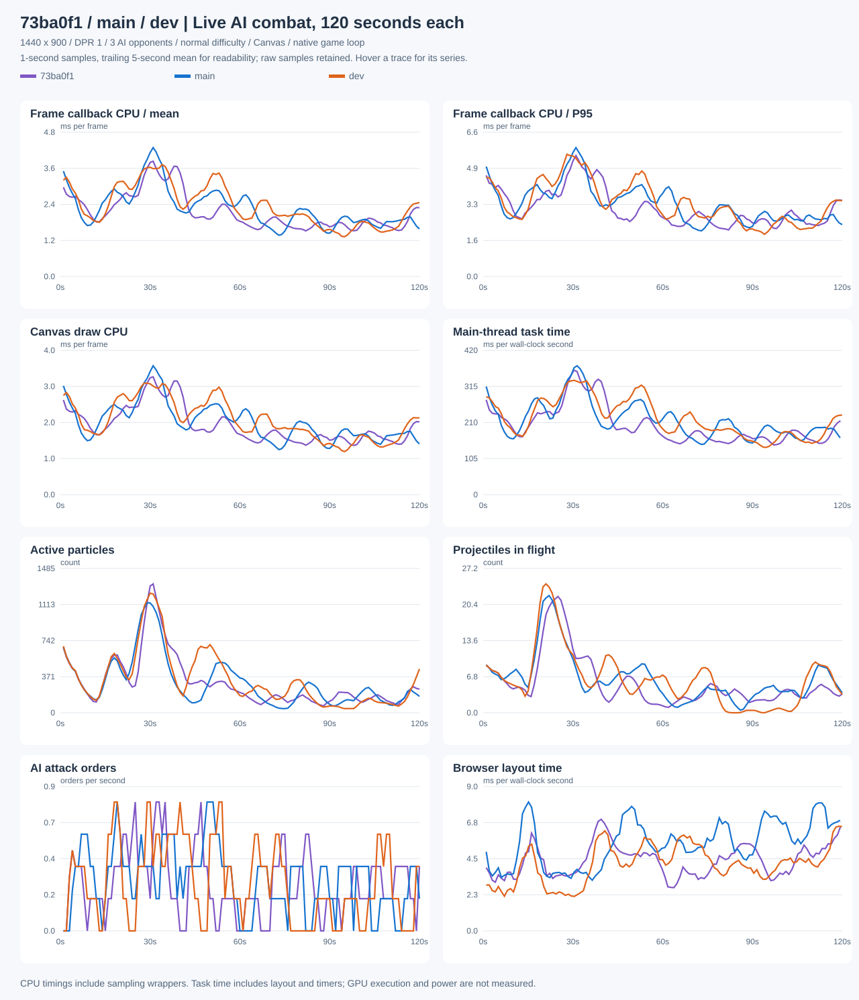

# Live combat comparison against 73ba0f1

Measured on 2026-11-09. The baseline is the exact user-selected commit 73ba0f126479f2fa940f9579c8217eb8654f3fdf. It already contains the earlier 0742bfe optimization; it precedes the subsequent lighting, text-label, transparent-effects and aircraft-trail optimization commits. It is not described here as a version before every historical optimization.

## Comparable setup

- Baseline: 73ba0f126479f2fa940f9579c8217eb8654f3fdf, original static scripts. Main: 73375a2, original static scripts after the Three.js rollback. Dev source: 58752cc, production Vite build, default Canvas.
- The new baseline run lasted 120.011 wall-clock seconds. Main and dev reuse the previously completed 120.010 / 120.008 second runs from the same session; they were not rerun for this comparison. Each revision has one measured run.
- Chromium 149.0.7827.55; ANGLE (AMD, AMD Radeon 780M Graphics (0x000015BF) Direct3D11 vs_5_0 ps_5_0, D3D11); 1440 x 900, DPR 1, headless. Native RAF and original game loops remain active.
- Same seed 1234567; normal difficulty; idle human player and three AI nations (mushroom/crazy, octopus/hot, ai/zen). Advance the original simulation to 180 seconds before measurement, then let it run live for 120 wall-clock seconds at 1x. No changes to initial aircraft, ammunition, AI, flight times or effects for this selected baseline.
- Start snapshot hashes match across all three revisions: true. Combat is not forced to replay identically. All three start with three living AI nations. Audio and network transport are excluded equally.
- Same test-only API and measurement wrappers as the prior comparison: full synchronous native RAF callback and Render.draw CPU timing every frame; particle and projectile counts every frame; CDP counters about once per second. Main-thread aggregate counters use complete intervals ending before 120 seconds. Initial/end screenshots are outside measurement.

## Results

This live-combat sample does not demonstrate a speedup after 73ba0f1. The selected baseline averaged 2.14 ms of callback CPU versus main's 2.24 ms and dev's 2.34 ms; all sustained approximately 60 RAF callbacks per second. Main and dev therefore used 4.9% and 9.2% more callback CPU in these runs. The baseline fired 84 munitions versus 93 on both later revisions; mean in-flight projectiles were 5.55 versus 6.31 and 6.26, while mean particles were 303 versus 302 and 342. These workload differences and one run per revision prevent assigning the observed difference solely to code changes.

| Metric | 73ba0f1 baseline | main | dev |
| --- | ---: | ---: | ---: |
| Frame callback CPU, mean (ms) | 2.14 | 2.24 | 2.34 |
| Frame callback CPU, P95 (ms) | 3.80 | 4.00 | 4.10 |
| Canvas draw CPU, mean (ms) | 1.90 | 1.97 | 2.05 |
| Main-thread task time (ms/s) | 201.91 | 214.78 | 221.07 |
| Layout time (ms/s) | 4.45 | 5.52 | 4.23 |
| Observed FPS | 60.00 | 60.00 | 60.00 |
| Frame interval P95 (ms) | 16.70 | 16.70 | 16.70 |
| Frame interval P99 (ms) | 16.80 | 16.80 | 16.80 |
| Frame gaps >25 ms | 0.00 | 0.00 | 0.00 |
| Frame gaps >50 ms | 0.00 | 0.00 | 0.00 |
| AI attack orders | 36.00 | 38.00 | 37.00 |
| AI-to-AI attack orders | 4.00 | 6.00 | 3.00 |
| Launched munitions | 84.00 | 93.00 | 93.00 |
| Explosions | 76.00 | 69.00 | 77.00 |
| Interceptions | 9.00 | 28.00 | 19.00 |
| Mean particles | 303.42 | 301.72 | 341.84 |
| Peak particles | 1669.00 | 1336.00 | 1607.00 |
| Mean in-flight projectiles | 5.55 | 6.31 | 6.26 |
| Peak in-flight projectiles | 24.00 | 23.00 | 25.00 |

Changes relative to 73ba0f1 (negative means less CPU time):

| Metric | main change | dev change |
| --- | ---: | ---: |
| Mean frame callback CPU | 4.9% | 9.2% |
| Frame callback CPU P95 | 5.3% | 7.9% |
| Mean Canvas draw CPU | 3.5% | 7.8% |
| Main-thread task time | 6.4% | 9.5% |
| Layout time | 24.0% | -5.0% |

The simulation ended at baseline: 300.0 s; main: 300.0 s; dev: 300.0 s. Game-over states: baseline: null; main: null; dev: null. Eliminations: baseline: 0; main: 0; dev: 0. Browser errors across included runs: 0.

This is a single live battle per revision. Attack counts, explosions and particle counts are included because natural battle divergence changes the workload. Differences are observed CPU measurements, not a controlled estimate of individual optimization gains, GPU completion time or energy use.

## Curves and evidence

Curves use one-second buckets with a trailing five-second mean. CPU P95 is calculated inside each one-second bucket before smoothing. Table statistics use all measured frames. Full callback CPU already includes draw CPU.

- [Open the comparison page](index.html)
- [Per-second summary](combat-summary.json)
- [Raw samples for all three revisions](combat-raw.json)

Raw frame columns: elapsed milliseconds, RAF interval milliseconds, callback CPU milliseconds, draw CPU milliseconds, simulation seconds, projectiles, particles, rings, fires. The first zero RAF interval is excluded from interval percentiles.
