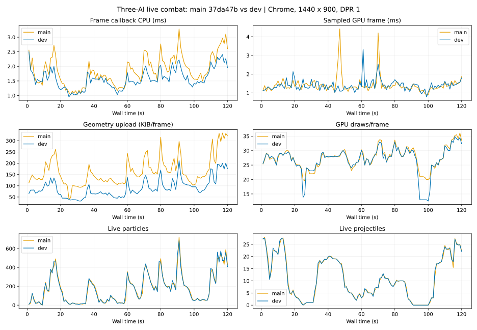

# Current-main GPU and DOM optimization results

## Outcome and revisions

Dev is rebuilt from main `37da47b639c56d87b14590eeb30c050f7ab1326c`. Old dev remains at `archive/dev-before-main-gpu-20261115`. The candidate runtime is `331c347` (behavior-identical to the measured working tree; only an explanatory comment was added after the combat run).

- `6ffa1db`: instanced smoke/glow layers, active-prefix trail uploads, empty-bloom suppression.
- `331c347`: retained ranking/research/resource DOM and inactive presentation suppression.
- Gameplay, AI, map generation, configuration, audio and networking source remain byte-identical to main. No Vue, full TS conversion, new runtime dependency, frame-rate reduction or density reduction was introduced.

## Live battle comparison

Chrome 156.0.8078.74, hardware ANGLE / AMD Radeon 780M / D3D11, WebGL2, 1440 x 900, DPR 1. One passive human seat and three normal-difficulty AI seats; seed 1234567; speed 1. The game first advances 60 simulation seconds, then runs its original RAF/simulation/AI loop for 120 real seconds on each revision, sequentially in the same browser. Audio is muted; the existing PixiJS 7.4.2 CDN asset is fulfilled locally to remove download variability. No production loop or combat rules are replaced.

Both runs start from the same full network snapshot and remain in active combat until approximately simulation second 180. AI attack pairs include 1→2, 1→3 and 2→1. There are 89/90 recorded launch, explosion and interception events. Average particle counts are 177.42/177.15 and projectile counts 11.02/11.04. Both keep quality 1 with no runtime errors or Canvas fallback.

| Measurement | Main | Dev | Interpretation |
| --- | ---: | ---: | --- |
| Frame callback CPU, mean | 1.847 ms | 1.578 ms | 14.5% lower |
| Frame callback CPU, p95 | 3.40 ms | 2.80 ms | 17.6% lower |
| Render submission CPU, mean | 1.584 ms | 1.334 ms | 15.8% lower |
| Geometry upload per callback | 163.65 KiB | 89.83 KiB | 45.1% lower |
| Main-thread task time | 179.97 ms/s | 161.77 ms/s | 10.1% lower |
| GPU elapsed time, mean | 1.421 ms | 1.393 ms | Small difference; no broad GPU-speed claim |
| GPU elapsed time, p95 | 2.129 ms | 1.996 ms | Workload- and scheduling-sensitive |
| Draw calls per callback | 27.50 | 26.82 | Slight reduction |
| RAF callbacks per second | 59.84 | 59.93 | Both near the existing cap |

CPU samples cover the callback and synchronous submission, including identical instrumentation. Asynchronous EXT_disjoint_timer_query_webgl2 queries cover one in six rendered frames; disjoint samples are discarded (1,197/1,199 valid samples). Buffer instrumentation counts bytes passed to bufferData/bufferSubData, not GPU memory usage. Main-thread task time comes from CDP Performance metrics. RAF rate is not a compositor-presented-FPS measurement. These are paired observations, not statistical confidence intervals.

[Performance curves](combat-curves.svg) · [One-second samples](combat-curves.csv) · [Summaries and starting state](combat-summary.json) · [Environment and runtime hashes](environment.json)

An earlier exploratory run starting at simulation second 180 is excluded: dev reached a loss screen early, so its later callbacks did not render. Its test warmup also omitted initialization of the visible map bounds, changing effect culling. The accepted pair initializes the renderer before warmup and checks continued combat, identical starting snapshots, workload counts and GPU activity. The excluded run is not used for improvement percentages.

## Controlled effects and DOM checks

A separate rendering-only fixture holds all five nuclear effect levels and an ultimate effect at the same age: 1,418 particles, 458 smoke submissions, 818 glow submissions and two procedural fireball shaders in each revision. The final paired 10-second sample measures 2.540→1.961 ms callback CPU and 424,260→249,012 uploaded bytes per frame (41.3% fewer bytes). GPU means are 2.062→1.903 ms; exploratory measurements varied, so the stronger conclusion is reduced CPU submission and upload traffic. This fixture supplements the live battle and does not substitute for it.

The original and instanced layers were also swapped within one frozen scene for direct visual inspection. Fireball shaders, shock distortion, smoke, sparks, bloom, ground lights and their order remain present. Atlas filtering and float opacity can produce small pixel differences. [Main effects](main-heavy.png) and [dev effects](dev-heavy.png) are available for review; [heavy-effect measurements](heavy-summary.json) preserve the final sample.

For 100 synchronous HUD refreshes changing population, bank and research values, main inserts/removes 144 ranking-row elements, 300 resource-root elements and 135 research-root elements. Dev inserts/removes **zero elements** in those three subtrees: whole-value text and styles change in place. Text-node replacement still occurs; this is not character-by-character HTML rewriting. The probe takes 17.2→5.5 ms, a microbenchmark rather than a live-frame timing. See [DOM counters](dom.json).

## Functional verification and remaining scope

- Identical full network snapshots after 180 deterministic simulation seconds with initialized viewport and fixed random sources.
- Browser interaction checks: target selection; nuclear, conventional and drone firing; research branch selection; shield, interception and ultimate abilities; crate collection; allocation/toggles; pause; developer lighting switch; retained row/icon identity; portrait layout; survival and quick-mode restart.
- Active instanced particles render after forced WebGL context loss and Pixi's automatic restoration. Explicit Canvas fallback renders successfully.
- Inactive frame callbacks submit no presentation work. The original host Worker advances the simulation while RAF callbacks are suppressed.
- Source mapping confirms authoritative sim/AI/net/config/audio files are unchanged. Syntax checks and git whitespace checks pass.

[Functional results](functional.json) · [Main battle](main-combat-valid120.png) · [Dev battle](dev-combat-valid120.png) · [Portrait check](portrait-functional.png)

Cross-device peer connections and every gameplay combination were not exhaustively exercised; multiplayer evidence here is unchanged source plus the host-worker check. The non-instancing path reuses the original Sprite implementation, but this hardware run uses WebGL2 instancing. Pixel-heavy shock and fireball shaders still dominate some GPU bursts; this iteration principally removes CPU scene-graph and data-transfer work. Further shader/transparent-fill reductions should be driven by a new GPU profile rather than attributed to the current results.
